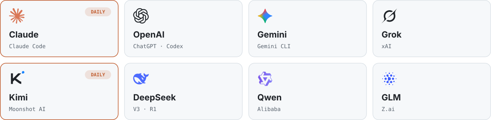

<picture>
  <source media="(prefers-color-scheme: dark)" srcset="./assets/banner-dark.svg">
  
</picture>

 

I'm a full-stack developer from Lisbon with 7+ years of experience. I take products from idea to production: database design, APIs, interfaces, payments, deploys and the monitoring that keeps them running.

Over the years I've built online stores, business dashboards, booking and event platforms, internal tools, automation pipelines and multiplayer game servers, both for clients and for my own projects.

### What I build

- **Web apps & dashboards** - Next.js and React front-ends on top of Prisma, Supabase and PostgreSQL, with auth, charts, email parsing and push notifications.
- **E-commerce** - custom Shopify themes in Liquid, storefront features and the back-office tools that run a store day to day.
- **APIs & automation** - FastAPI and Node.js services, browser automation with Playwright, scheduled jobs and third-party integrations.
- **AI features** - transcription, translation, subtitles and voice dubbing with Whisper, TTS and FFmpeg, plus LLM integrations inside real products.
- **Infrastructure** - Linux servers, Docker, CI/CD, backups and alerting, so what I ship stays up.
- **Multiplayer game servers** - backend systems for Minecraft, FiveM and Counter-Strike communities: Java plugins, Lua resources, on-demand server orchestration and player queues.

### AI I work with

<picture>
  <source media="(prefers-color-scheme: dark)" srcset="./assets/ai-dark.svg">
  
</picture>

I use all of the frontier models, with **Claude** and **Kimi** as my daily drivers: coding agents to ship faster, MCP to connect models to real tools, and AI features built straight into the products I deliver.

### Stack

<table>
<tr><td><b>Languages</b></td><td>
          
</td></tr>
<tr><td><b>Frontend</b></td><td>
            
</td></tr>
<tr><td><b>Backend</b></td><td>
           
</td></tr>
<tr><td><b>Data</b></td><td>
       
</td></tr>
<tr><td><b>AI & ML</b></td><td>
     
</td></tr>
<tr><td><b>Cloud & infra</b></td><td>
          
</td></tr>
<tr><td><b>Testing & tooling</b></td><td>
          
</td></tr>
</table>

 

<picture>
  <source media="(prefers-color-scheme: dark)" srcset="https://raw.githubusercontent.com/rafael-carvalho-developer/rafael-carvalho-developer/output/snake-dark.svg">
  
</picture>

  

Most of my work lives in private repositories. Happy to walk you through any of it.

